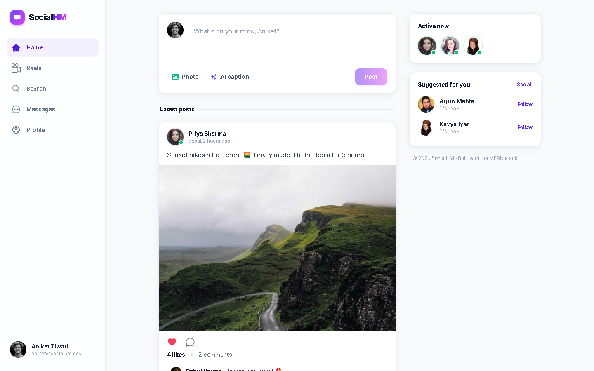
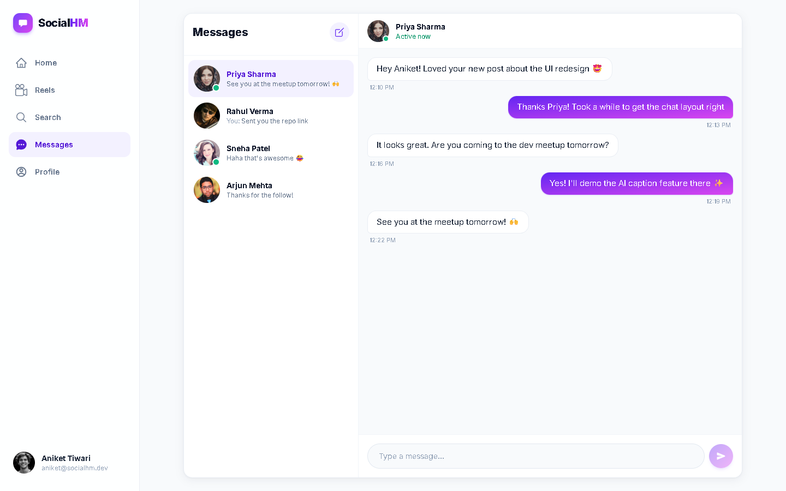
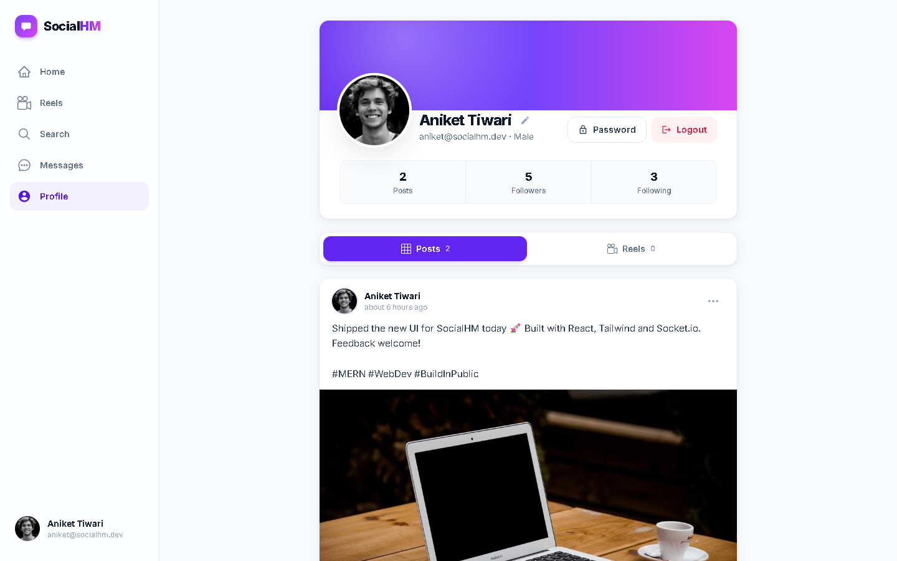
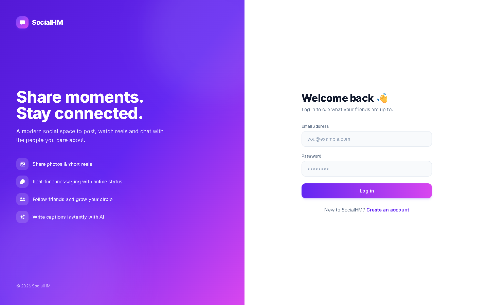
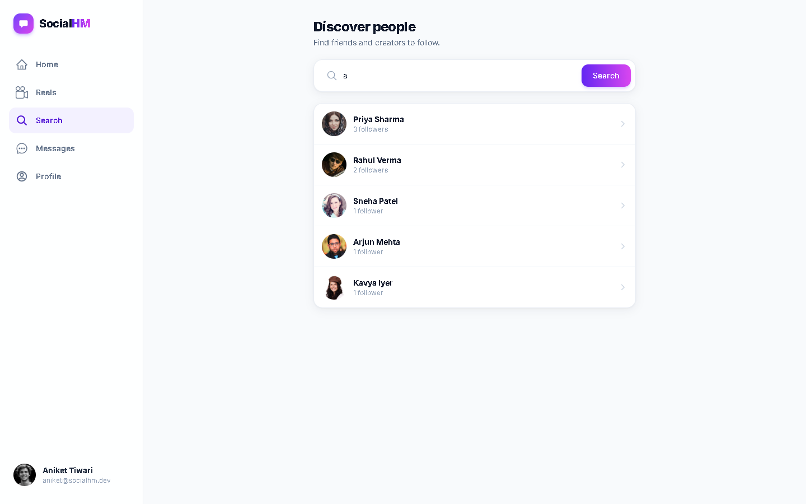
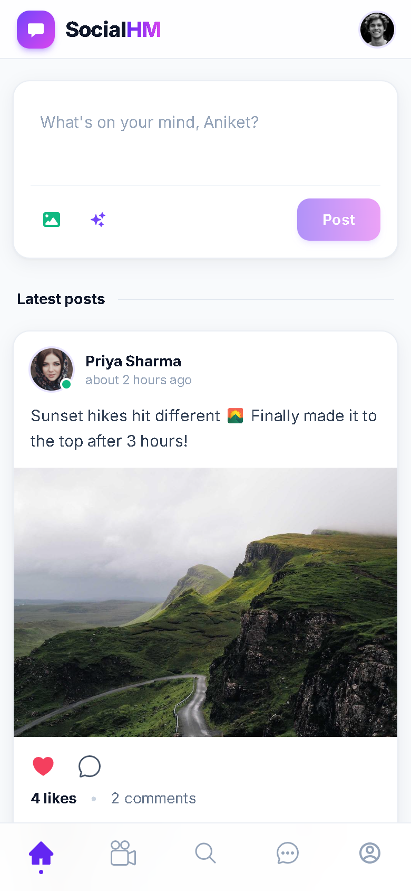
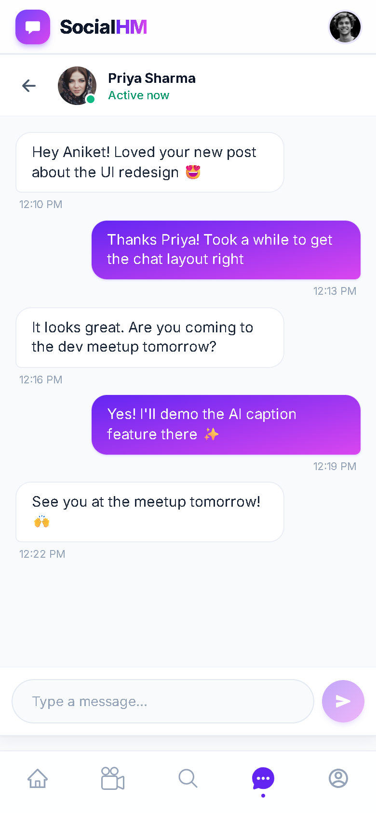
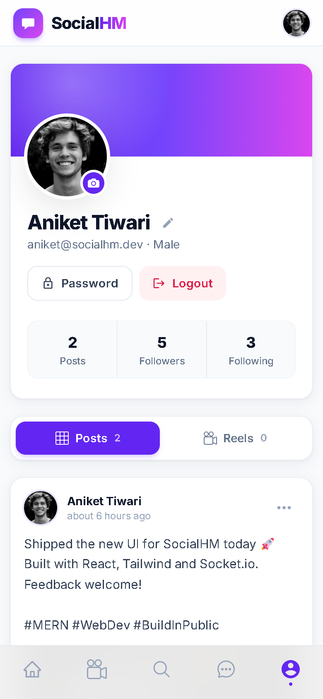

<div align="center">

# 💬 SocialHM

**A full-stack MERN social media app: share posts and reels, follow friends, chat in real time and write captions with AI.**

[](https://socialmediahm.vercel.app/)


</div>

---

## 🌐 Live demo

👉 **https://socialmediahm.vercel.app/**

Create an account (any email works) and start posting, following and chatting.

## 📸 Screenshots

> Screenshots were taken with demo users and sample content.

### Home feed


### Real-time chat


### Profile


<table>
  <tr>
    <td width="50%"><b>Login</b><br></td>
    <td width="50%"><b>Discover people</b><br></td>
  </tr>
</table>

### 📱 Mobile

<p align="center">
  
  &nbsp;
  
  &nbsp;
  
</p>

## ✨ Features

| | Feature | Details |
|---|---|---|
| 🔐 | **Authentication** | Register with a profile photo, log in and log out. JWT stored in an HTTP-only cookie, passwords hashed with bcrypt |
| 📝 | **Posts** | Upload images with captions, edit captions, delete your own posts |
| 🎬 | **Reels** | Upload short videos and browse them one at a time |
| ❤️ | **Likes & comments** | Like or unlike posts (or double-tap the photo), see who liked them, add and delete comments |
| 👥 | **Follow system** | Follow or unfollow users and view follower and following lists |
| 💬 | **Real-time chat** | One-to-one messaging over Socket.io with timestamps and live online status |
| 🟢 | **Online presence** | Green dot on avatars of users who are currently online |
| ✨ | **AI caption generator** | Enter a topic and Google Gemini writes a ready-to-post caption (rate-limited to 5 per minute per user) |
| 🔎 | **Discover people** | Search users by name and get "Suggested for you" recommendations |
| 👤 | **Profile management** | Change your profile photo, name and password |
| 📱 | **Responsive UI** | Sidebar navigation on desktop, bottom tab bar on mobile |

## 🛠 Tech stack

**Frontend:** React 18, Vite, React Router v6, Tailwind CSS, Axios, Socket.io-client, react-hot-toast, react-icons, date-fns

**Backend:** Node.js, Express, MongoDB with Mongoose, Socket.io, JWT, bcrypt, Multer and DataURI, Cloudinary for media storage, Google Generative AI (Gemini)

**Deployment:** Vercel

## 📁 Project structure

```
Mern-Social-master/
├── backend/
│   ├── controllers/     # auth, user, post and message logic
│   ├── database/        # MongoDB connection
│   ├── middlewares/     # isAuth (JWT), multer uploads, rate limiter
│   ├── models/          # User, Post, Chat, Messages
│   ├── routes/          # /api/auth, /api/user, /api/post, /api/messages, /api/ai
│   ├── socket/          # Socket.io server and online-users map
│   ├── utils/           # token generation, CORS whitelist, helpers
│   └── index.js         # Express app entry point
├── frontend/
│   └── src/
│       ├── components/  # PostCard, AddPost, NavigationBar, modals, chat UI
│       ├── context/     # User, Post, Chat and Socket React contexts
│       └── pages/       # Home, Reels, Search, Chat, Account, UserAccount, Login, Register
├── vercel.json
└── package.json
```

## 🚀 Getting started

### Prerequisites

- Node.js 18 or later
- A MongoDB database (local or [MongoDB Atlas](https://www.mongodb.com/atlas))
- A [Cloudinary](https://cloudinary.com/) account
- A [Google Gemini API key](https://aistudio.google.com/app/apikey), needed for the AI caption feature

### 1. Clone the repo

```bash
git clone https://github.com/Anikettiw-at/socialmediahm.git
cd socialmediahm
```

### 2. Configure environment variables

Create a `.env` file in the project root:

```env
PORT=7000
MONGO_URL=your_mongodb_connection_string
JWT_SEC=your_jwt_secret

Cloudinary_Cloud_Name=your_cloud_name
Cloudinary_Api=your_cloudinary_api_key
Cloudinary_Secret=your_cloudinary_api_secret

GEMINI_API_KEY=your_gemini_api_key

# Optional: extra allowed frontend origins (comma-separated)
CLIENT_URL=http://localhost:5173
```

For a deployed frontend, set `VITE_BACKEND_URL` to your backend URL. It defaults to `http://localhost:7000`.

### 3. Install dependencies

```bash
npm install
npm install --prefix frontend
```

### 4. Run in development

Start the backend on port 7000:

```bash
npm run dev
```

In a second terminal, start the frontend on port 5173:

```bash
npm run dev --prefix frontend
```

Then open http://localhost:5173.

### 5. Production build

```bash
npm run build
```

## 📡 API overview

| Method | Endpoint | Description |
|---|---|---|
| POST | `/api/auth/register` | Register (multipart, includes profile photo) |
| POST | `/api/auth/login` | Log in |
| GET | `/api/auth/logout` | Log out |
| GET | `/api/user/me` | Current user |
| GET | `/api/user/all?search=` | Search users |
| GET | `/api/user/:id` | User profile |
| PUT | `/api/user/:id` | Update name or profile photo |
| POST | `/api/user/:id` | Change password |
| POST | `/api/user/follow/:id` | Follow or unfollow |
| GET | `/api/user/followdata/:id` | Followers and followings |
| POST | `/api/post/new?type=post\|reel` | Create a post or reel |
| GET | `/api/post/all` | All posts and reels |
| GET | `/api/post/:id` | Users who liked a post |
| PUT / DELETE | `/api/post/:id` | Edit caption or delete post |
| POST | `/api/post/like/:id` | Like or unlike |
| POST / DELETE | `/api/post/comment/:id` | Add or delete a comment |
| GET | `/api/messages/chats` | Your conversations |
| GET / POST | `/api/messages/:id`, `/api/messages` | Read or send messages |
| POST | `/api/ai/generate-post` | Generate a caption with Gemini |

## 🔒 Security

- CORS whitelist for the API and the Socket.io connection
- Socket connections are authenticated
- HTTP-only JWT cookies
- Rate limiting on the AI endpoint
- Regex-escaped user search to prevent ReDoS
- Atomic MongoDB updates for likes and follows

## 🤝 Contributing

Pull requests are welcome. For major changes, open an issue first to discuss what you'd like to change.

## 👨‍💻 Author

**Aniket Tiwari** · [GitHub @Anikettiw-at](https://github.com/Anikettiw-at)

If you like this project, consider giving it a ⭐!
